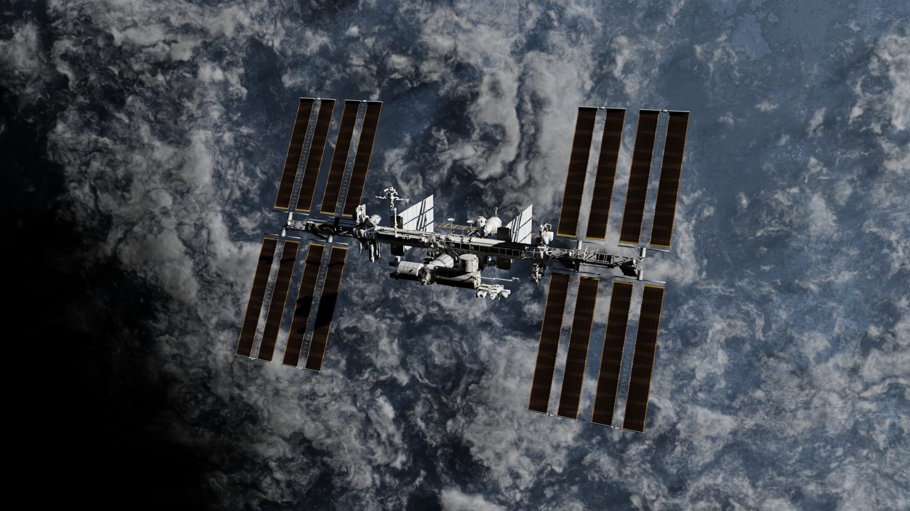
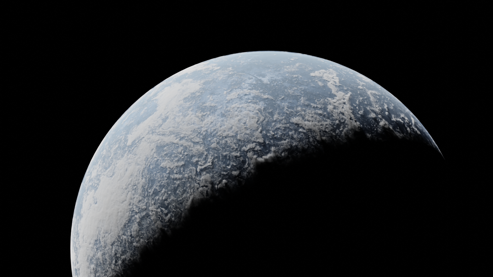
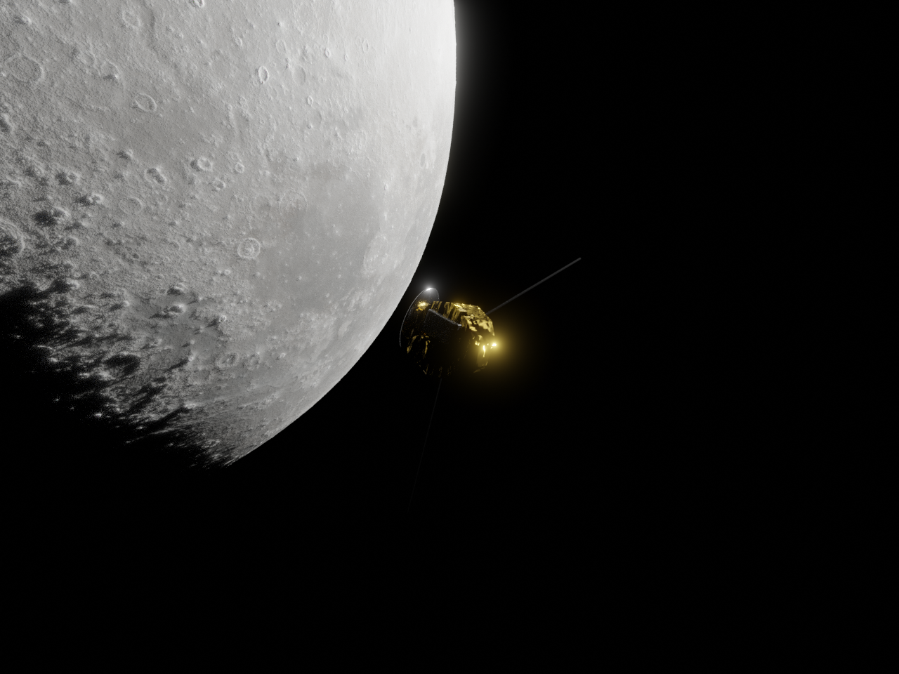
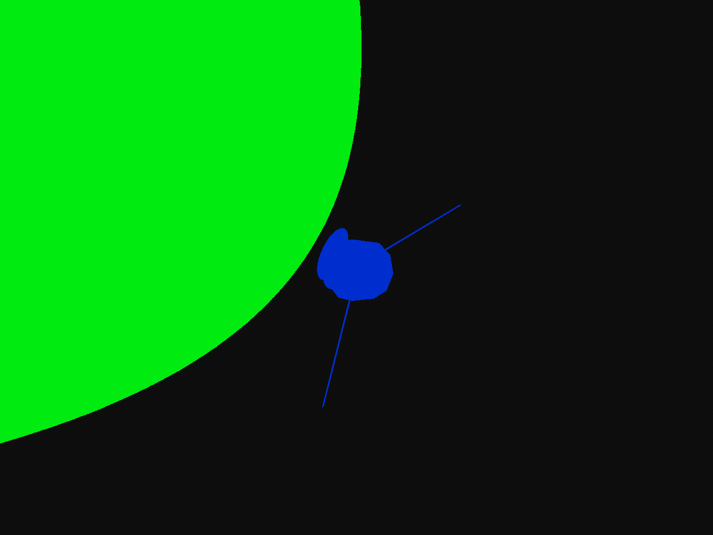
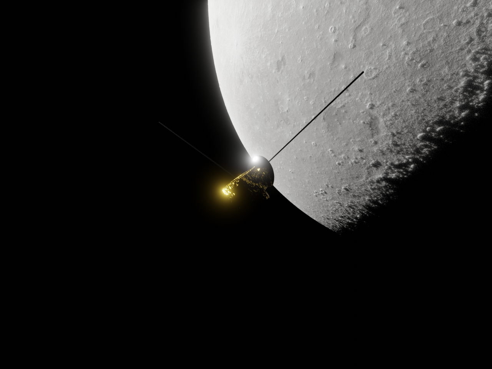
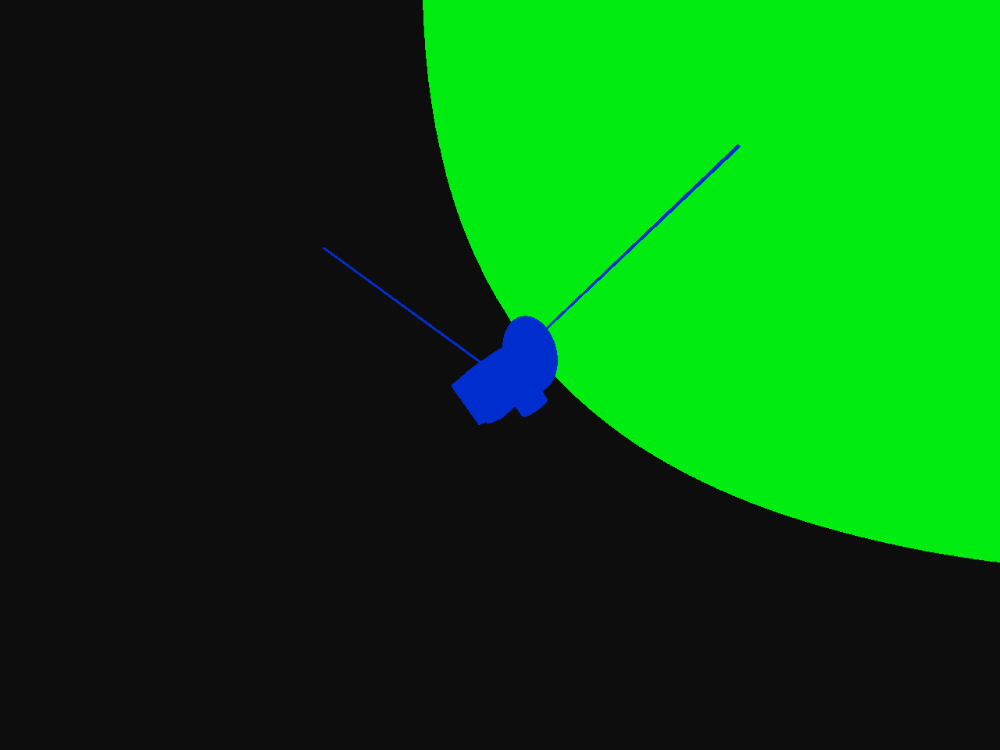
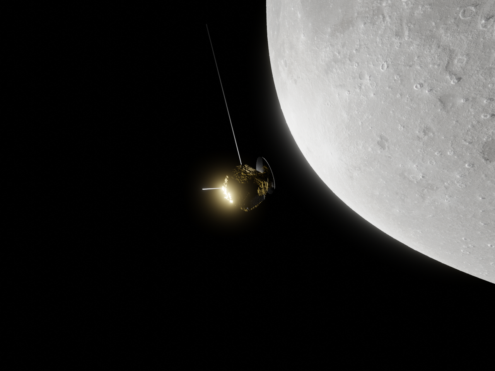
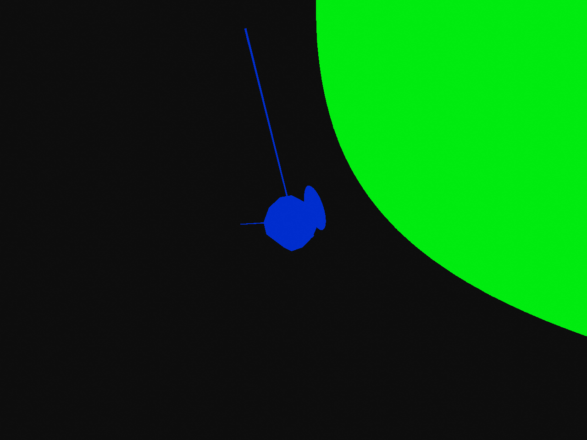
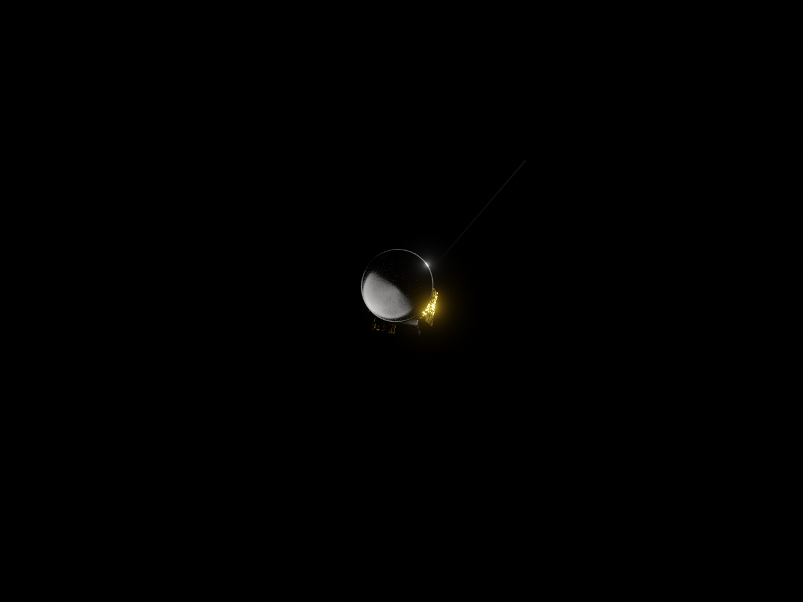
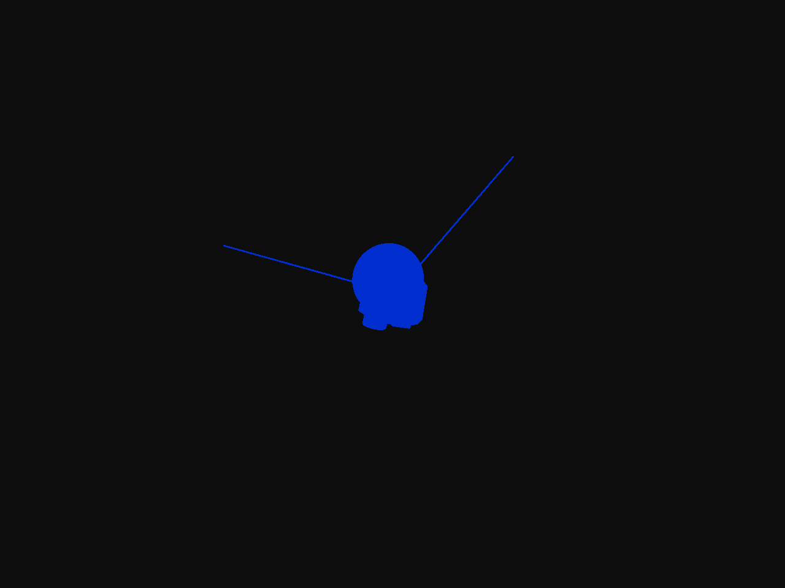

# Introduction

OAISYS can create on-orbit space simulations and generate photorealistic renderings using a variety of modalities. Users can spawn celestial bodies and place satellites in orbit around them. The following images show example outputs.






n this section, we explain how to create space scenes with OAISYS. To make the process as easy as possible, we provide several basic assets and an example configuration file. The goal of this tutorial is to simulate a probe orbiting the Moon and render images similar to the following examples.

<div style="display: flex; gap: 10px;">
  
  
</div>
<div style="display: flex; gap: 10px;">
  
  
</div>
<div style="display: flex; gap: 10px;">
  
  
</div>
<div style="display: flex; gap: 10px;">
  
  
</div>


If you want to directly try it out you can run the simulation with:

`python3 run_oaisys.py --blender-install-path /path/to/blender/ --config-file ./cfgExamples/OAISYS_Aeroconf2026_example01.json`


## Simulate Celestial Bodies

First, we need to set up the celestial body around which our satellite will orbit. In principle, any object can be used as a celestial body. Many models of planets, moons, and asteroids are available online. To make getting started easier, we provide a model of the Earth’s Moon in this repository.

To spawn a celestial object, we use the _MeshSingle_ module, as shown below:


```json
{
"name": "moon",
"type": "MeshSingle",
"meshParams":
    { "meshFilePath":"oaisys_data/examples/assets/meshes/celestial_bodies/moons/earth_moon/moon.blend",
      "meshInstanceName": "moon",
      "rotation_deg": [0,0,0],
      "scale": [1.0, 1.0, 1.0],
      "position": [0, 0, 0],
      "instanceLabelActive": true,
      "randomSwitchOnOff": false,
      "passParams":       {   "rgb": {},
                              "semantic_label": {"labelIDVec": [[2400,2400,100,100]]},
                              "instance_label": {}
                           }}
}
```

_meshFilePath_ defines the path to the .blend file of the celestial body, while _meshInstanceName_ specifies the name of the object in that file that should be used in the simulation. The next three parameters: _rotation_deg_, _scale_, and _position_, define the rotation, scale, and position of the mesh, respectively.

## Satellite Module

Next, we define a satellite object that will orbit around the Moon. For this, we use the _MeshSatelliteObject_ module, which allows you to specify the object in OAISYS around which the spawned object will orbit. This can be done as follows:

```json
{
"name": "sat", 
"type": "MeshSatelliteObject",
"meshParams":
    { "meshFilePath":"oaisys_data/examples/assets/meshes/satellites/moon_sat.blend",
      "meshInstanceName": "sat",
      "rotation_deg": [0,0,180],
      "scale": [0.000069332079, 0.000069332079, 0.000069332079],
      "instanceLabelActive": true,
      "randomSwitchOnOff": false,
      "orbit_params": {
          "type": "circular",
          "parent": "moon",
          "scale": [1.4, 1.4, 1.4],
          "rotation_deg": [30, 30, 0],
          "v_step": 0.01,
          "orbit_start": 15.0
      },
      "oaisys_drivers": { "material_drivers": {
                                      "drivers": {
                                          "scale": {
                                              "clip_min": 0.1,
                                              "clip_max": 10.0,
                                              "ideal": 1.0,
                                              "jitter_variance": 10.0
                                          },
                                          "location": {
                                              "clip_min": 0.0,
                                              "clip_max": 1000.0,
                                              "ideal": 0,
                                              "jitter_variance": 1000.0
                                          },
                                          "rotation": {
                                              "clip_min": 0.0,
                                              "clip_max": 1000.0,
                                              "ideal": 0,
                                              "jitter_variance": 1000.0
                                          }
                                      },
                                      "jitter_strength": 1.0,
                                      "step_interval": 1
      }},
      "passParams":{   "rgb": {},
                       "semantic_label": {"labelIDVec": [[500,500,500,500]]},
                       "instance_label": {}
                    }}
}
```

The dictionary _orbit_params_ lets you define the orbit of the satellite.

## Sensor Module for Space Missions
Next, we set up the sensors to define how the satellite is observed. OAISYS provides several options: you can sample random positions around the satellite or create different types of approach trajectories.

The following shows an example configuration for the sensor:

```json
"SENSOR_SETUP": {
    "GENERAL": {
        "sensorMovementType":"orbit_object",
        "orbit_mesh": "sat",
        "orbit_radius": 0.0007,
        "orbit_radius_noise": 0.0,
        "approach_moving_type": "spiral",
        "approach_moving_params": { "sensor_start_v": 0.00001,
                                    "sensor_end_v": 0.000001,
                                    "relative_sensor_start_position": [0.001,-0.001,0],
                                    "relative_sensor_end_position": [0.0001,-0.0001,0],
                                    "r_start": 0.0001,
                                    "r_end": 0.001,
                                    "plane":  "xy",
                                    "rotations": 3},
        },
	"SENSORS": [{"type": "SensorCameraRGBD",
				 "sensorParams": {
				    "outputBaseName":"sensor_1",
					"imageResolution": [640,480],
					"KMatrix": [541.14,	0,			320,
								0,		541.14,		240,
								0,		0,			1],
					"transformation": [0.0,0,0,1.0,0.0,0,0],
					"triggerInterval": 1,
					"renderPasses": {
					    "RGBDPass": {"activationSlot":[1], "DepthEnabled": true},
						"SemanticPass": {"activationSlot":[1,1]},
						"InstancePass": {"activationSlot":[1]}
						}
					}
				}]
}
```